  
   
  
  

---

## About

I'm **Saima Sheikh**, a Computer Science Engineering student interested in building practical software across **applied AI/ML, NLP, full-stack development, and cloud engineering**.

My projects explore how intelligent systems can support real workflows: extracting and reconciling information from documents, routing natural-language requests, analyzing structured outputs, and automating cloud-security checks. I value clear system boundaries, explainable results, and honest evaluation over inflated claims.

- **Focus areas:** Applied AI/ML · NLP · Full-Stack Engineering · Cloud Automation
- **Application development:** React · Next.js · Node.js · Express
- **AI / document workflows:** Semantic retrieval · NLP inference · OCR · PDF processing
- **Cloud / infrastructure:** AWS · Terraform · Docker

## Featured Projects

<table>
  <tr>
    <td width="50%" valign="top">
      <h3><a href="https://github.com/saima2501/BhoomiLens">BhoomiLens</a></h3>
      
AI-assisted land-record digitization and review workflow. Explores OCR, structured extraction, deterministic consistency checks, document-integrity signals, and human review with official-source verification.

      
<strong>Stack:</strong> Python · OCR · AWS · Amazon Bedrock · Next.js

      
<a href="https://bhoomi-lens-omega.vercel.app">Live demo</a>

      Hackathon MVP. Uses synthetic reference data and does not claim to prove document authenticity.
    </td>
    <td width="50%" valign="top">
      <h3><a href="https://github.com/saima2501/TenderIQ">TenderIQ</a></h3>
      
Explainable procurement bid-compliance analysis combining semantic retrieval, natural-language inference, numeric/unit validation, and cross-document evidence reconciliation.

      
<strong>Stack:</strong> Python · Sentence-BERT · NLI · TF-IDF · PDF processing · Ollama

      
<a href="https://tenderiq-frontend-lyart.vercel.app/">Live demo</a>

      Academic project evaluated with a controlled synthetic dataset; not validated on live GeM submissions.
    </td>
  </tr>
  <tr>
    <td width="50%" valign="top">
      <h3><a href="https://github.com/saima2501/AiElectionForecastingBot">ElectIQ</a></h3>
      
Full-stack AI analysis application with multi-provider inference, server-sent event streaming, structured responses, and interactive analytical visualizations.

      
<strong>Stack:</strong> React · Vite · Node.js · Express · Groq · Gemini

      
<a href="https://aielectionforecastingbot-1.onrender.com">Live demo</a>

    </td>
    <td width="50%" valign="top">
      <h3><a href="https://github.com/saima2501/A-Self-Adaptive-Intent-Aware-Natural-Language-Query-Routing-System-with-Automated-Team-Allocation">Intent-Aware Query Routing</a></h3>
      
NLP pipeline that embeds natural-language requests, predicts intent, returns ranked class probabilities, and supports downstream team-allocation workflows.

      
<strong>Stack:</strong> Python · Sentence Transformers · scikit-learn-compatible classifier · Joblib

    </td>
  </tr>
  <tr>
    <td width="50%" valign="top">
      <h3><a href="https://github.com/saima2501/College-DP">College Discovery Platform</a></h3>
      
Full-stack decision-support application for college search, filtering, side-by-side comparison, rank-based discovery, and placement/admission information.

      
<strong>Stack:</strong> Next.js · TypeScript · Tailwind CSS · Node.js · Express · PostgreSQL · Prisma

      
<a href="https://frontend-blue-two-97.vercel.app">Live demo</a>

    </td>
    <td width="50%" valign="top">
      <h3><a href="https://github.com/saima2501/aws-sg-compliance-checker">AWS Security Group Compliance Checker</a></h3>
      
Terraform-provisioned serverless workflow that audits EC2 Security Group rules, produces JSON/CSV reports, stores results in S3, and sends notifications.

      
<strong>Stack:</strong> Terraform · AWS Lambda · EventBridge · S3 · SNS · IAM · CloudWatch · Python/Boto3

    </td>
  </tr>
</table>

## Technical Toolkit

| Area | Technologies evidenced in my projects |
|---|---|
| **Languages** | Python, JavaScript, TypeScript, SQL |
| **Frontend** | React, Next.js, Vite, Tailwind CSS, Framer Motion, Recharts |
| **Backend & Data** | Node.js, Express.js, PostgreSQL, Prisma, SQLite, REST APIs, Server-Sent Events |
| **AI / ML / NLP** | Sentence Transformers, Sentence-BERT, NLI cross-encoders, TF-IDF, semantic retrieval, OCR, PDF text extraction |
| **Cloud & DevOps** | AWS, Terraform, Docker, Vercel, Render, Git, GitHub |

## GitHub Activity

  

Activity visualization is provided by a third-party service. GitHub's contribution calendar on my profile remains the source of truth.

## Find Me

- **Portfolio:** [my-portfolio-nu-sand-18.vercel.app](https://my-portfolio-nu-sand-18.vercel.app)
- **GitHub:** [github.com/saima2501](https://github.com/saima2501)

---

  Building thoughtfully. Learning continuously. Shipping with care.

